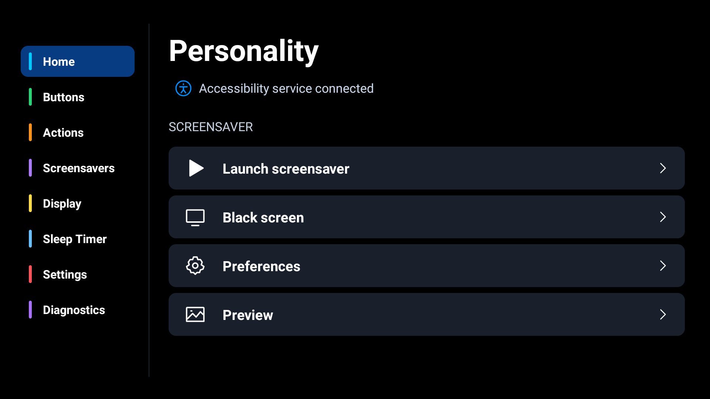

# Personality for Android TV

Personality lets you remap remote buttons, loop local video screensavers, and set a sleep timer.

**Languages:** English and Russian. Change the language in Settings.



[Screen saver library](docs/screensavers.png) · [Settings](docs/settings.png)

## Install

1. Download the APK from [Releases](https://github.com/investor63/personality-android-tv/releases).
2. Transfer it to your Android TV and open it with a file manager.
3. If prompted, allow the file manager to install apps.
4. For remote button mappings, enable Personality under Android Accessibility.

Support for individual remote buttons depends on the device firmware. Tested on Xiaomi MiTV-MOOQ1 with Android 11.

## Screensavers

Open Screensavers, import a video from internal storage or USB, and launch it. Keep the USB drive connected during playback.

The black screen action displays an overlay. Back or the assigned button restores the picture.

## Build

Open the project in Android Studio with Android SDK 36 installed. Run:

```shell
./gradlew assembleDebug testDebugUnitTest
```

On Windows, use `gradlew.bat`. The debug APK is in `app/build/outputs/apk/debug/`.
